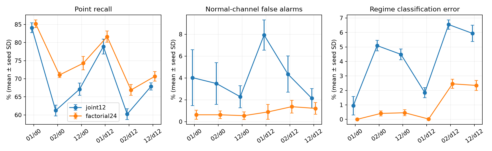
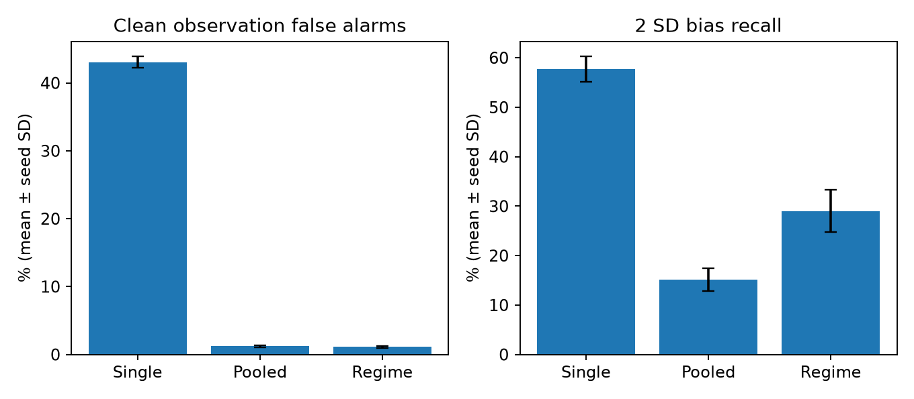

# RQ2机制深化与RQ1独立确认：本轮研究发现

2026-11-01。本轮完成一轮有限诊断、一个轻量候选验证和一次RQ1独立确认；没有新增预测训练，没有修改65模型/RQ3正式测试或英文稿。

## 1. 最有价值的发现：故障组合会改变工况推断的失败方式

12状态模型在单振动强故障时有价值，但两个传感器同时异常时，互斥的单故障解释可能把剩余偏差归于工况。正常通道随后被错误工况参考判为异常。这不是单纯“异常越强越容易检出”：参考本身受到污染，会同时漏检故障并牵连正常通道。

诊断复用5种子×64批旧val观测，26个完整配对条件（干净；三单通道/三双通道×2/4倍偏置；记录延迟0/12步）。同时考察正负符号和切换前6步/切换时起始；不是只挑一个有利组合。诊断和后续验证各320个基础批次，视图不计为独立样本。

## 2. 轻量改进及开发验证结果

仅将互斥单故障状态改成三个可组合故障位，构成3工况×8掩码的24状态过滤器。沿用原工况参考、κ=4的协方差膨胀、记录似然、EWMA和评分公式。每位的初始/出现/恢复概率继承原参数0.01/0.001/0.1；无新增拟合参数。用同一原训练校准集校准分支阈值。

在另一组每种子64批旧val观测（索引64—127）上比较，以下是4倍偏置+12步记录延迟，五种子均值：

| 双故障组合 | 逐点召回：12→24状态 | 正常通道牵连误报：12→24状态 | 全时间轴工况错误率：12→24状态 |
|---|---:|---:|---:|
| 温度+湿度 | 78.89% → **81.62%** | 7.93% → **0.89%** | 1.85% → **0.02%** |
| 温度+振动 | 60.22% → **66.89%** | 4.35% → **1.37%** | 6.55% → **2.45%** |
| 湿度+振动 | 67.88% → **70.67%** | 2.14% → **1.21%** | 5.94% → **2.34%** |

以上三项指标、三种组合的改善均在5/5种子出现。无延迟强双故障也有同向改善。完整逐种子差、描述性区间、全部组合和基线见`results/rq12/20261101/analysis_v1/paired_comparisons.csv`，不把多场景区间当校正后的确认显著性。

图中0/1/2依次为温度/湿度/振动，d0/d12为记录延迟；误差条是五种子SD，非置信区间。

### 同时保留的代价与新线索

- 干净观测的误报基本保持，延迟干净条件均约1.00%。
- 单振动4倍偏置+延迟12步：逐点召回63.66%→61.58%，牵连误报1.03%→1.35%；事件新增检出均99.69%。新机制不全局替换原模型。
- 两个含振动的强双故障组合，合并0/12延迟的事件后前6步，原故障通道恢复正常后的误报34.92%→43.63%；随后剩余时间降至约1.28%→1.36%。与此同时事件内工况错误明显减少。这支持“更真实的故障残差被恢复后，固定EWMA记忆产生恢复拖尾”的解释；是同一存档窗口分析，没有新增调参实验。
- 2倍偏置下部分工况/正常通道指标轻微退步。因此本轮最强证据集中在强双故障污染参考的机制，而非普适最优。

## 3. RQ1：一次有限独立确认已完成

新随机流namespace2026110102，五个种子各36条固定工况序列，共180条、每条160步。原E1b训练参考与校准阈值完全冻结；生成机制不改，干净与2/4倍单通道偏置配对。新数据只用于评价，不用于调参。

| 对比 | 新确认结果 | 解释 |
|---|---|---|
| single→pooled，干净误报 | 43.05%→1.20%；差−41.85个百分点，95%区间[−42.98,−40.72] | 覆盖全部合法工况，主要解决参考覆盖不足 |
| pooled→regime，2倍偏置逐点召回 | 15.14%→29.00%；差+13.87个百分点，95%区间[10.42,17.31] | 条件化恢复被合并分布掩盖的局部异常 |
| pooled→regime，干净误报 | 1.20%→1.11% | 条件化增量主要在检出，而非进一步大幅压低误报 |
| pooled→regime，4倍偏置召回 | 47.71%→92.43% | 次要描述性结果，与2倍结果方向一致 |

两个预定主比较均5/5种子同向；Holm校正p分别1.06×10⁻⁷和0.000364，区间以五种子为外层单位、df4。独立确认限于同一合成家族和冻结参考；single还使用较少训练行，不将覆盖对比解释成纯样本量已控制的因果效应。

## 4. 创新价值与下一步

本轮支持一个可深化的贡献：**把多传感器并发故障视作对共享工况参考的污染来源，以可组合故障解释保护参考，再分别评价检出、牵连和恢复拖尾。** 这比笼统增加异常检测准确率更有机制解释。

因子化隐状态及多传感器故障牵连已有基础工作：[Ghahramani与Jordan，1997](https://mlg.eng.cam.ac.uk/pub/pdf/GhaJor97a.pdf)；[多传感器故障识别与smearing-out研究](https://arxiv.org/abs/1909.02449)。本轮增量候选在于与工况记录不确定性、原Trust Score及可解释配对诊断的结合，不声称发明因子化HMM。这里是有针对性的初步比较，尚非完整新颖性检索。

当前最小后续建议：固定这个候选，做一次小型全新评分留出验证，并用删除双故障状态的结构消融分离“允许组合”的贡献与先验变化；继续保留单故障、干净及恢复窗口。无需新预测模型，不立刻追求所有指标同时最优，也不增加其他候选算法。RQ3与英文稿保持冻结；11/28总目标不变。

## 5. 验证与保存

7项核心测试通过；独立复核诊断99840行、候选验证133120行、RQ1表720行及全部清单/后验/告警/配对指标。诊断约15.4秒，四组验证约22.7秒；没有训练成本。图形单独用现有绘图环境渲染，实验与统计使用Python3.11.17。

每阶段五种子完整输入、掩码、工况后验、偏离比例、告警、参数及逐批表均归档到GitHub ZIP；另存校验清单、完整汇总与代码。软件准备阶段一条测试路径错误、绘图依赖缺失的日志保留；它们不涉及实验结果筛选。旧来源文本的本地下载副本仅多一个末尾换行，原内容及参数与远端逐项一致。

SBS：本轮仅核对既有资料位置与时间记录，未发现新提供的过程—检验配对或现场实施反馈；真实资料没有上传公开仓库。继续沿现有最小现场方案等待可实施条件，不阻塞本轮RQ1/RQ2。

### 新增组合状态的实际使用证据

对已归档候选输入重放24状态后验，130个种子—视图的工况后验与存档逐元素相同。强双故障叠加延迟时，事件窗口内“至少两个通道故障”的工作后验质量分别为92.00%（温湿）、61.23%（温振）、62.98%（湿振）；干净条件仅约0.0007%。单振动强故障的组合状态占用由无延迟0.27%升至延迟2.55%，为局部退步提供了可检验线索。这里是模型内部解释，不是经过真实故障校准的概率。完整表见`posterior_hypothesis_mass.csv`。
