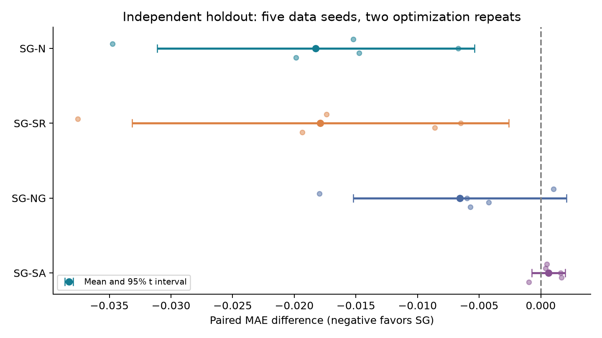
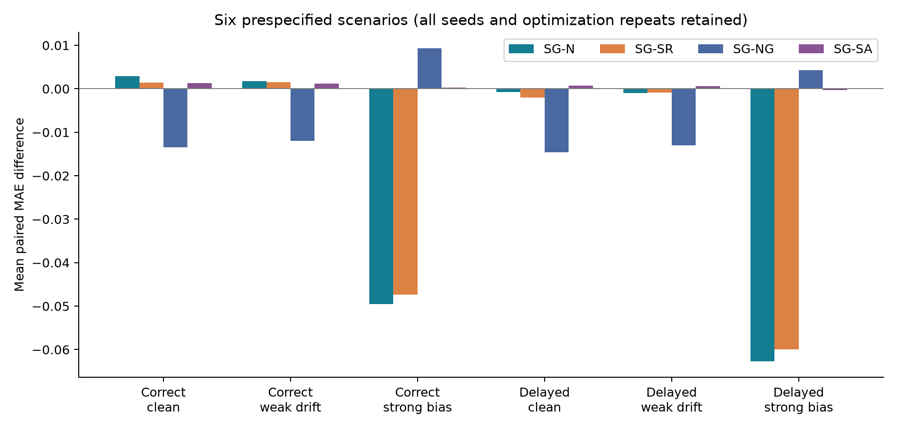
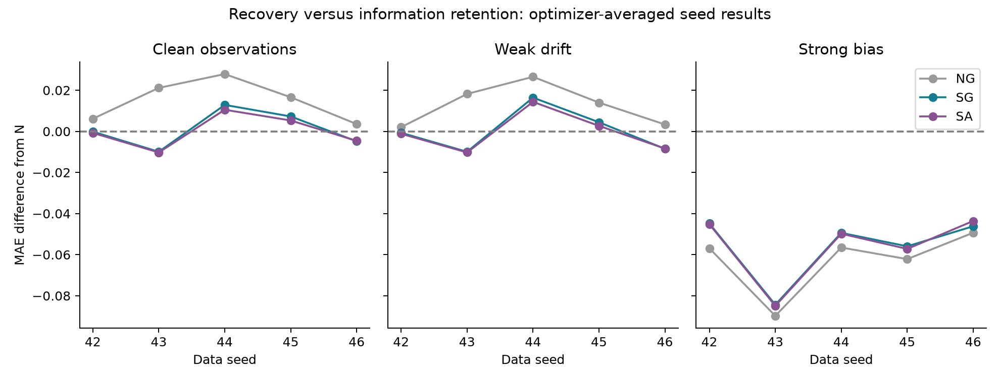
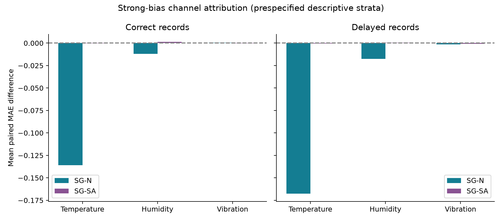

# A Regime-Aware Sensor-Level Trustworthiness Estimation Method for Quality Prediction in Petrochemical Transportation and Storage

## Abstract

Quality prediction during petrochemical transportation and storage relies on sensor observations, yet legitimate operating-regime changes and measurement contamination can both alter readings. A reference fitted to one regime can therefore flag valid observations from another, while aggregate anomaly scores obscure the affected channels. We estimate sensor-level trust as consistency with the current regime, separating reference coverage from conditioning and retaining channel-level evidence for detection and prediction. The score also guides selective correction: observations within the calibrated acceptance region remain intact, whereas larger deviations receive progressively stronger reference-based correction. In synthetic development validation, pooling all legitimate regimes reduced clean false alarms from 43.25% to 1.25%; regime conditioning improved discrimination in some contamination settings, although cross-channel residuals could raise alarms on clean channels. On a separately generated synthetic holdout for a future temperature-exposure proxy, selective score-guided correction reduced six-scenario mean absolute error from 1.625892 to 1.607635 against an otherwise matched no-score predictor, and outperformed randomized-score correction. These results connect regime-aware observation assessment to a tested, selective use of trust information for prediction while preserving the distinction between sensor consistency and product quality.

## I. Introduction

Environmental and operating conditions can change during the storage, loading, and transportation of petrochemical products, producing different sensor distributions. Measurements are often collected frequently, whereas quality assays may be delayed or sparse. Quality management consequently relies on process records alongside limited quality information. Research on mixed-oil length estimation in multiproduct pipelines illustrates how transport-data modeling can support product-mixing control [4]. Both legitimate operating changes and measurement contamination can cause deviations, motivating assessment relative to the current regime and an independent examination of its value for quality prediction.

Existing research shows that local models and model fusion provide references for different operating conditions [1]; mode recognition, domain adaptation, and robust regression support quality estimation under degradation [2,5]; and sensor-dependency models produce channel-level anomaly scores [3]. However, when legitimate regime differences coexist with measurement contamination, improved aggregate monitoring or quality estimation does not establish the consistency of individual readings with their current regime or demonstrate downstream benefits from channel scores. Reference coverage and conditioning must be distinguished, while contamination detection, clean-channel false alarms, and predictive utility require separate assessment.

To address these issues, this study proposes a regime-aware sensor-level trustworthiness estimation method. Reliable training observations establish regime-conditioned references; channel residuals and causal temporal accumulation represent observation deviations; and scores with their availability indicators support both prediction features and selective correction of suspect observations. Three research questions examine the method. RQ1 compares pooled and conditioned references at matched legitimate-regime coverage, separating insufficient coverage from conditioning. RQ2 jointly evaluates detection, localization, and event recovery to identify the benefits and costs of cross-channel relationships and memory policies. RQ3 first tests score features under matched information and then tests whether selective score-guided correction improves future quality prediction against no-score and randomized-score controls. Controlled comparisons examine reference selection, cross-channel relationships, and temporal memory, while quality-prediction errors assess the application value of additional scoring features.

## II. Related Work and Background

### 2.1 Observation Assessment Across Operating Regimes in Transportation and Storage

Sensor observations during petrochemical transportation and storage reflect both operating regimes and measurement conditions. Environmental conditions and operations differ across storage, loading, and transportation, so a sensor's distribution can change even when its measurement is accurate. Multimode process-monitoring research shows that references should represent these legitimate differences [1]. Judging anomalies solely by deviation from a fixed reference can confound normal regime changes with measurement contamination; aggregating channel deviations into a global alarm also discards information useful for localization. Observation assessment must therefore specify both the current reference regime and the channel being assessed.

Quality prediction additionally requires observation consistency, measurement contamination, and product quality to be distinguished. An accurate temperature reading consistent with the current regime can still indicate storage or transportation conditions unfavorable to product quality. A trust score is therefore not itself a quality score. Prediction targets also differ. Yang et al. [4], for example, estimated the distribution and interval of mixed-oil length from pipeline features and conditional diffusion models. Their pipeline-control target differs from future product quality. The question here is whether trust scores estimated for each sensor under the current regime improve prediction by a given model while retaining the original observations and regime inputs.

### 2.2 Related Methods and Their Conditions of Use

Multimode monitoring addresses legitimate operating differences by adjusting reference models. Quiñones-Grueiro et al. [1] reviewed single-model, local-model, and model-fusion approaches. Normal switching also calls for treatment of transitions: Zhao et al. [10] separated common and regime-specific subspaces and recognized transitions to distinguish normal changes from abnormal disturbances; Shang et al. [11] combined conditionally independent Bayesian regime identification with recursive transformed-component analysis for incipient sensor-fault detection and isolation, replacing some window samples at switches to reduce normal alarms. These studies show that reference choice and switching treatment both affect monitoring. In transportation and storage, timely regime records and reference coverage also matter. Pooling legitimate regimes can itself resolve single-reference mismatch, so the additional role of conditioning must be tested at matched coverage.

Sensor-level anomaly assessment retains channel deviations for contamination localization. Deng and Hooi's graph deviation network [3] learned dependencies among sensors, formed channel deviation scores from prediction residuals, and aggregated them into time-point anomaly scores. It offers a method reference for multivariate monitoring, though its water-system experiments do not establish petrochemical quality-prediction gains. Residuals use different information: marginal residuals compare a channel with its own reference, cross-channel residuals compare concurrent relationships, and temporal prediction residuals use history. A contaminated input can alter the residual of another clean channel. Sensor-level evaluation must therefore consider detection and localization together with false alarms on clean channels.

Multimode soft sensing and robust regression directly address quality estimation with complex observations. Zhang et al. [2] combined regime recognition, domain adaptation, and local Gaussian processes and evaluated quality estimation under sensor degradation using Tennessee Eastman and polypropylene-production data. Their polypropylene case injects degradation into real process data, providing an example for studying disturbed measurements. Xie and Chen [5] used a Dirichlet process to select mixture components and Student-t distributions for robust regime recognition and output regression. These approaches address regime differences and disturbed observations through domain adaptation, local modeling, or robust regression. The effect of trust scores as additional features still needs a matched predictor type and available-history range. Current-quality soft sensing, future-quality prediction, and arrival-quality prediction must also be distinguished by target time.

Reliability assessment provides another link between observation analysis and quality estimation. Siegl et al. [12] evaluated the reliability of submodels from their deviations relative to sliding-window regression, removing deviating submodels and weighting the remainder for biomass soft sensing without immediate online reference values. Kong et al. [13] used within-variable temporal relations and a cross-variable graph to assess transient noise and persistent drift, then improved disturbed-input representations by graph message passing in cement soft sensing. These studies show paths from reliability assessment to prediction, but their assessment targets and score uses differ. Here, trust estimates describe the consistency of each sensor observation with expected behavior under the current regime, and their predictive value is tested through input comparisons with the same predictor type.

### 2.3 Approach and Contribution Scope

Prior work provides methods for multimode monitoring, sensor-level anomaly assessment, and reliability-assisted soft sensing. Applying these ideas to petrochemical transportation and storage raises three connected questions: whether references cover legitimate regimes, whether channel-level assessment supports contamination localization, and whether trust scores help quality prediction. These concern reference modeling, observation assessment, and prediction, respectively. A reduction in aggregate alarms or a local increase in detection cannot answer all three.

For transportation and storage quality prediction, the method produces sensor-level trust estimates from regime-conditioned references. Reliable historical observations establish statistical references for each regime; the regime record available at scoring time selects the reference. Channel residuals, causal temporal accumulation, and calibration yield trust scores. State rules handle regime-record changes and missing observations, while a separate availability indicator distinguishes low trust from an unavailable score. Scores and availability enter the quality predictor alongside observations, missingness indicators, and regime information, so both readings and deviations from the current reference can be used.

With fitted training parameters, trust scores are derived from visible observation histories and regime records; they are not independent new measurements. They make deviations from the current reference explicit as predictive features. To test this representation, pooled and conditioned scores are compared at matched regime coverage; contamination detection, channel localization, and post-event false alarms are assessed together; and predictor type, historical range, and data partition are held comparable when separating score availability from continuous scores. Detection and predictive value have distinct metrics, and conclusions are limited to the regimes, contamination conditions, and prediction models evaluated.

## III. Problem Modeling and Proposed Method

### 3.1 Problem Definition

Sensor distributions may differ across storage, calm transportation, and more strongly vibrating transportation. The same reading can have different expected ranges under different regimes. A fixed reference can thus misclassify legitimate regime variation, while measurement biases can produce similar deviations.

This paper defines the trustworthiness of a sensor observation as its consistency with expected behavior under the current regime. Estimating that degree is termed trustworthiness estimation, and its numerical output is a trust score. Observation consistency explains the score's meaning; it is not a separate metric.

A trust score describes deviation from a regime reference. It is neither the probability that a measurement is correct nor a direct assessment of product quality. A high temperature can accurately reflect current conditions while being unfavorable for quality. Observation consistency, measurement contamination, and product quality therefore require separate evaluation.

For sequence $n$ with $p$ sensors, let $\mathbf{x}_{n,t}$ be the observation at time $t$. Using observations and regime records available by then, the method outputs sensor-level trust scores $\mathbf{s}_{n,t}$ and score-availability indicators $\mathbf{b}_{n,t}$. These join observations, missingness indicators, and regime information as quality-prediction inputs. The sequence index $n$ is omitted below.

RQ1 separates the effects of legitimate-regime coverage and conditioning on false alarms and contamination detection. RQ2 assesses contaminated-channel detection and localization together with clean-channel false alarms. RQ3 tests whether trust scores improve quality prediction with matched predictor type and available information. The questions are evaluated through reference comparisons, detection and localization metrics, and quality-prediction errors, respectively.

### 3.2 Assumptions and Scope

Reference learning requires reliable training observations representing legitimate regimes. Reliability means measurements reflect the underlying process, not that product quality is acceptable. Synthetic experiments use clean training sequences to separate reference construction from contamination effects. This does not establish automatic selection of reliable samples from unknown contaminated histories.

Let $r_t$ be the actual regime and $\widetilde r_t$ the available record. They coincide for correct, timely records but may differ under delay. Reference selection and resets use $\widetilde r_t$; actual regimes support generation and stratified evaluation only. Ideal-label and delayed-record experiments do not establish automatic regime recognition.

Covered regimes form $\mathcal R_{\mathrm{tr}}$. Uncovered recorded categories produce unavailable scores rather than forced assignment. This does not guarantee detection of unknown regimes incorrectly recorded as known categories. Deviations can also result from process change or reference mismatch, so low scores cannot determine contamination causes.

Data are partitioned by complete sequences, batches, or appropriate temporal blocks before window construction. A base sequence and its contaminated versions remain in the same partition; windows and target intervals do not cross partitions. Training is divided into reference-fitting data $\mathcal D_{\mathrm{fit}}$ and calibration data $\mathcal D_{\mathrm{cal}}$. Preprocessing, references, and thresholds use training data; validation supports selection and testing evaluates fixed configurations.

### 3.3 Observation and Quality Prediction Modeling

Let $z_{t,j}$ be the latent clean value, $\delta_{t,j}$ additive contamination, and $m_{t,j}$ observation availability:

$$x_{t,j}=z_{t,j}+\delta_{t,j}\quad(m_{t,j}=1),\qquad x_{t,j}=\mathrm{NA}\quad(m_{t,j}=0).$$

Multiplicative errors, saturation, and stuck sensors require separate mechanisms. Missingness is recorded through $m_{t,j}$. Simulated clean values and injection labels are used only for the specified reference-training setting and evaluation, and are excluded from deployed scoring inputs.

Quality prediction uses an information window of length $L$ ending at $t$:

$$\widehat y_{t+h\mid t}=f_{\Phi}(\mathcal H_t^L),\qquad h>0.$$

Here $\Phi$ denotes predictor parameters. Regular sampling gives a lead time of $h\Delta t$. Current-quality estimation corresponds to $h=0$; arrival and batch-end tasks require separately defined target times.

Assay $k$ is sampled at $u_k$ and released at $v_k$ as $\ell_k$, representing quality at sampling. Later results can support retrospective evaluation but cannot enter earlier inputs. True historical quality is excluded by default. If deployment permits historical assays, only $v_k\leq t$ results are available, equally across groups. With temporal partitions, training labels must also be available before the training cutoff.

The target must have an interpretable relationship with available inputs. Short environmental windows may not identify independently varying initial quality and cannot be assumed sufficient for absolute-quality prediction. The variable, interval, window, and horizon depend on actual data. Arrival assays are not replicated into time-resolved ground truth.

### 3.4 Regime-Conditioned References

“Regime-aware” describes the overall use of regime information available at scoring time. “Regime-conditioned” denotes the specific mechanism: separate statistical references and calibration parameters are fitted for each regime and selected by the visible regime record. The method does not imply automatic regime recognition.

The method selects a regime reference, computes channel residuals, accumulates them over time, and maps calibrated deviations to trust scores with availability indicators. The default uses regime-conditioned marginal residuals, EWMA accumulation, and resets at record changes. Pooled references, conditional residuals, and alternative temporal statistics serve as comparators for the corresponding mechanisms.

Training means $\bar x_j$ and scales $\sigma_j$ define shared standardized coordinates:

$$\xi_{t,j}=\frac{x_{t,j}-\bar x_j}{\sigma_j}.$$

The single-regime reference estimates its center and covariance from one regime; the pooled reference uses all covered regimes; the conditioned reference estimates separate parameters and selects them using the available record:

$$\boldsymbol\mu_t=\boldsymbol\mu_{\widetilde r_t},\qquad \boldsymbol\Sigma_t=\boldsymbol\Sigma_{\widetilde r_t},\qquad \widetilde r_t\in\mathcal R_{\mathrm{tr}}.$$

Single-versus-pooled comparison assesses the effect of extending legitimate-regime coverage. Pooled-versus-conditioned comparison assesses the overall effect of conditioning at matched coverage. Because the conditioned scheme uses both regime-specific references and regime-specific calibration, this comparison captures their joint effect and does not attribute it solely to changes in reference parameters.

Standardization is common to all methods. Covariance uses Ledoit–Wolf shrinkage [6], with precision $\mathbf P_t=\boldsymbol\Sigma_t^{-1}$.

The signed marginal residual is

$$d^{\mathrm{mar}}_{t,j}=\frac{\xi_{t,j}-\mu_{t,j}}{\sqrt{\Sigma_{t,jj}}}.$$

It evaluates a channel relative to its own center and scale without directly using other current observations. Conditional residuals use other channels to form

$$\widehat\xi_{t,j}=\mu_{t,j}-\frac{\mathbf P_{t,j,-j}}{P_{t,jj}}(\boldsymbol\xi_{t,-j}-\boldsymbol\mu_{t,-j}),$$

$$d^{\mathrm{cond}}_{t,j}=\sqrt{P_{t,jj}}(\xi_{t,j}-\widehat\xi_{t,j})=\frac{[\mathbf P_t(\boldsymbol\xi_t-\boldsymbol\mu_t)]_j}{\sqrt{P_{t,jj}}}.$$

The index $-j$ denotes other channels. This is a standardized conditional residual under a Gaussian reference; outside that assumption, it represents deviation from a linear conditional reference. Contaminated inputs can affect clean-channel residuals, requiring joint assessment of detection and bystander alarms.

### 3.5 Sensor-Level Trust Scoring and Temporal Memory

Pointwise evaluation uses the current residual. Persistent signed deviations are accumulated using the established EWMA recursion [7]:

$$g_{t,j}=\alpha d_{t,j}+(1-\alpha)g_{t-1,j},\qquad 0<\alpha\leq1.$$

Setting $\alpha=1$ recovers pointwise evaluation. The default uses marginal residuals and $\alpha=0.2$. Accumulation precedes the absolute value, allowing same-sign deviations to accumulate and opposing deviations to cancel, without future observations.

Independent sequences start from zero. A recorded regime change clears history before the current residual updates it. Unavailable residuals produce unavailable scores and clear the corresponding memory; recovery restarts from zero. Injected event boundaries never trigger resets. The carry policy removes only the regime-change reset: current residuals and thresholds still use the new reference. It may preserve cross-switch contamination evidence or prolong record-mismatch effects.

Statistics are computed along complete calibration sequences for each reference, residual, and aggregation method. With reference index $\kappa$,

$$q_{\kappa,j}=Q_{0.99}\left(\{|g_{t,j}|:(t,j)\in\mathcal D_{\mathrm{cal}},\ \kappa_t=\kappa\}\right).$$

Conditioned methods calibrate by regime, pooled methods use pooled data, and the single reference uses its corresponding regime. Sequences initialize independently with evaluation-consistent recursions and resets. Deviation and consistency are

$$a_{t,j}=\frac{|g_{t,j}|}{q_{\kappa_t,j}},\qquad s_{t,j}=\exp\left(-\frac{a_{t,j}^2}{2}\right).$$

An alarm occurs when $a_{t,j}>1$. Scores decrease with deviation without a correctness-probability interpretation. Empirical quantiles do not guarantee 1% evaluation FPR; realized FPR is reported. Availability $b_{t,j}$ requires the target observation for marginal residuals and complete current inputs for conditional residuals. Unknown regimes or unmet requirements yield unavailable scores, interpreted as neither normality nor detected contamination.

As a temporal-aggregation comparator, full-window SMA uses $W=9$ consecutive available residuals:

$$g^{\mathrm{SMA}}_{t,j}=\frac{1}{W}\sum_{\ell=0}^{W-1}d_{t-\ell,j}.$$

A new complete window is required after sequence initialization, record changes, or missing residuals. Scores are unavailable until then. Two-sided CUSUM follows the established construction [8]:

$$C^+_{t,j}=\max(0,C^+_{t-1,j}+d_{t,j}-k),$$

$$C^-_{t,j}=\max(0,C^-_{t-1,j}-d_{t,j}-k),\qquad g^{\mathrm{CUSUM}}_{t,j}=\max(C^+_{t,j},C^-_{t,j}).$$

The reference value is fixed at $k=0.5$ with empirical training calibration. No immediate reset follows alarms, allowing continuous scoring and recovery assessment. Sequence boundaries, record changes, and unavailable residuals still reset the state. Comparisons retain detection, clean-channel false alarms, event response, recovery, and coverage rather than judging overall performance by local recall alone.

### 3.6 Integration with Quality Prediction

The forecast origin is fixed before the target: observations through $t$ predict $y_{t+h}$ with $h>0$. A periodic assay is evaluated only at its sampling time, and an arrival assay supplies one batch-end target rather than a fabricated time series. All input processing is causal. The original feature comparison uses observations and missingness indicators (B0), then adds visible regime information (B1), score availability (B2), and continuous trust scores (B3). B3 versus B2 isolates the additional score representation under the same predictor family, split, window, and selection rule. Scores are derived from those inputs and fitted training references; they provide an explicit representation, not an independent observation.

The later confirmation tests a distinct use of the same consistency-score transformation: correcting selected sensor inputs before prediction. Its scoring branch filters 12 regime–fault states (three regimes crossed with no fault or one of three affected channels). The causal posterior $\pi_t(z,f)$ combines Gaussian observation likelihood, the available-record likelihood and prespecified regime and fault transitions; $q_t(z)=\sum_f\pi_t(z,f)$ is the filtered regime probability. For a fault hypothesis $f=j$, the regime covariance is inflated by $4^2\Sigma_{z,jj}\mathbf e_j\mathbf e_j^\top$ on channel $j$. A matching regime record has likelihood 0.9 and each nonmatching regime 0.05. These are working statistical assumptions, not calibrated probabilities of physical fault causes.

Unlike the hard-regime residual in Section 3.5, the confirmation score uses a posterior-weighted marginal transform. For standardized observation $v_{t,j}$, regime marginal mean $\mu_{z,j}$ and standard deviation $\sigma_{z,j}$, let $u_{t,j}=\sum_z q_t(z)\Phi((v_{t,j}-\mu_{z,j})/\sigma_{z,j})$ and $a_{t,j}=\Phi^{-1}(\operatorname{clip}(u_{t,j},10^{-12},1-10^{-12}))$. The causal memory is $g_{t,j}=0.2a_{t,j}+0.8g_{t-1,j}$, reset before updating at a visible-record change. A channelwise threshold $\tau_j$ is the training-calibration 0.99 quantile of $|g_{t,j}|$ pooled across correct and 12-step-delayed records. The ratio $r_{t,j}=|g_{t,j}|/\tau_j$ gives $S_{t,j}=\exp(-r_{t,j}^{2}/2)$. The no-fault-hypothesis scoring branch is calibrated separately. The accepted boundary $r_{t,j}=1$ corresponds to $S_0=\exp(-1/2)$. With regime reference means $\mu_{z,j}^{\rm phys}$ in physical sensor units, define

$$c_{t,j}=\sum_z q_t(z)\mu_{z,j}^{\rm phys},\qquad \lambda_{t,j}=\left[1-\frac{S_{t,j}}{S_0}\right]_+,\qquad \widetilde x_{t,j}=x_{t,j}+\lambda_{t,j}(c_{t,j}-x_{t,j}).$$

Thus accepted observations ($r_{t,j}\leq1$) remain unchanged; correction increases continuously outside that region. The boundary comes from the existing calibration, without tuning it against quality labels. A continuous-correction comparator uses $\lambda_{t,j}=1-S_{t,j}$. For paired uncorrupted observations $x^0$, define injection error $e=x-x^0$ and reference error $b=c-x^0$. Then $(\widetilde x-x^0)^2=(1-\lambda)^2e^2+\lambda^2b^2+2\lambda(1-\lambda)eb$. This identity explains why removing corruption and retaining useful normal variation can conflict; $x^0$ includes ordinary measurement noise and is not latent physical truth.

The selective-correction experiment keeps the LSTM architecture and common inputs fixed across five arms: no-score prediction (N), continuous correction with actual scores (NG), selective correction with actual scores (SG), selective correction with randomized training-pool scores (SR), and selective correction without the fault hypothesis in the scoring branch (SA). All arms receive the same full-candidate filtered regime posterior. SG–SA therefore tests the incremental fault hypothesis conditional on this common posterior, not the entire regime-inference pipeline. The score-feature comparison and selective-correction comparison answer different parts of RQ3 and are not pooled into a single effect.

## IV. Experiments and Comparative Analysis

### 4.1 Experimental Environment and Synthetic Data

Experiments use Python 3.11.16 with NumPy, pandas, SciPy, and scikit-learn. Seeds are fixed at 42-46. Sequence and event metrics are aggregated within each seed before calculating means and sample standard deviations across five repetitions. Standard deviations are not confidence intervals, and correlated time points are not independent experiments.

The regimes are storage, smooth transportation, and rough transportation; channels are temperature, relative humidity, and vibration. A shared autoregressive latent variable and independent channel disturbances create temporal and cross-channel dependence. The autoregressive coefficient is 0.85 and factor loadings are 0.8, -0.6, and 0.5. Table 4-1 defines illustrative statistical differences, not product-calibrated handling limits.

Table 4-1  Generating means and standard deviations

|Regime|Temperature/K|Humidity/%RH|Vibration/(mm/s)|
|---|---|---|---|
|Storage|295.0±2.0|50.0±4.0|0.40±0.05|
|Smooth transport|301.0±2.5|52.0±5.0|1.50±0.15|
|Rough transport|304.0±3.0|45.0±6.0|3.00±0.30|

Note: ± denotes the generating standard deviation, not uncertainty in an estimate.

Initial reference comparisons use 160-step fixed-regime sequences containing spikes, segment biases, drift, missingness, and random replacement. Each seed and regime has 8 fitting, 4 calibration, 4 validation, and 4 test sequences. Numerical contamination uses pooled training-channel scales; missingness is separate. Subsequent stress tests use 180-step sequences and segment biases scaled by within-regime training standard deviations.

Switching preserves standardized disturbances while changing regime means and scales. Record delays keep observations unchanged and delay only scoring inputs. These are instantaneous distribution changes, not physically calibrated transitions. The controlled baseline contains two 12-step, single-channel events per sequence at magnitude 1. Paired comparisons vary duration over 4, 12, and 24 steps; count over 1, 2, and 3; and magnitude over 1, 2, and 4. Additional onsets occur six steps before, at, or six steps after a switch.

Final testing uses 60 previously held-out sequences: 12 per seed, each 180 steps long. Four methods and parameters are fixed before testing, using archived training references and thresholds. Twelve scenarios reuse base sequences in paired comparisons rather than forming 720 independent sequences. Development and final testing belong to the same synthetic family but are interpreted separately. Cross-protocol differences do not measure method improvement. The RQ1–RQ2 evidence is fixed to project snapshot 434b502, which records the protocols and archived results underlying Tables 4-2 through 4-6 [9]. The independent RQ3 confirmation is fixed to the later archived protocol and results [14]; its batches, target and predictor are separate from the scoring benchmark.

The RQ3 confirmation retains the existing synthetic generating law and target: an observed 118-step prefix predicts a temperature-exposure proxy at step 180. This is a constructed future target, not an industrial quality assay. Five data seeds (42–46) each provide 1000 training and 250 validation sequences. After training and checkpoint selection, 500 new test batches per seed were generated under a separate namespace, giving 2500 independent test batches. Six paired views cross correct or 12-step-delayed regime records with clean observations, one-scale weak drift or four-scale strong bias. Each contaminated view retains the paired latent process and target. Two prespecified six-step-delay views serve as secondary stress checks.

### 4.2 Comparators and Evaluation Metrics

References include single-regime marginal, pooled marginal, regime-conditioned marginal, and pooled and conditioned conditional residuals. Temporal comparisons use pointwise, EWMA, full-window SMA, and two-sided CUSUM statistics. The reset ablation changes only memory retention at record updates, leaving observations, references, thresholds, and events unchanged.

Thresholds use the 0.99 quantile of independent training calibration sequences. Matched nominal quantiles do not ensure matched realized false-positive rates, so detection and false alarms are reported together. Final testing compares regime-conditioned marginal and conditional residuals with pointwise and EWMA statistics. SMA, CUSUM, and carry evidence comes from development experiments.

Detection uses time-sensor cells and reports precision, recall, F1, and average precision from deviations:

$$\mathrm{Precision}=\frac{\mathrm{TP}}{\mathrm{TP}+\mathrm{FP}},\quad \mathrm{Recall}=\frac{\mathrm{TP}}{\mathrm{TP}+\mathrm{FN}},\quad \mathrm{F1}=\frac{2\mathrm{TP}}{2\mathrm{TP}+\mathrm{FP}+\mathrm{FN}}.$$

Clean counterparts have no injected positives and assess false alarms, not detection F1 or recall. Clean-counterpart FPR measures alarms on uncontaminated trajectories; uncontaminated-cell FPR in contaminated trajectories includes propagation and persistence; bystander FPR is restricted to clean channels at contaminated times. Their denominators differ.

Localization includes Top-1, all-fault recall, and exact fault-set rate. All-fault recall requires all contaminated channels to be alarmed but allows additional alarms; exact-set rate requires complete agreement. Top-1 is conditional on contamination being present and only checks whether the largest deviation identifies a contaminated channel, not whether an alarm is raised.

Fresh-event detection requires a no-alarm-to-alarm transition during contamination. Pre-existing alarms are not automatic new detections. Delay is reported among detected events and with misses assigned event duration; the latter is not actual mean detection time. Post-event FPR concerns clean cells on the previously affected channel within 12 steps of termination, deduplicating windows and excluding renewed contamination.

For unavailable scores, common-support and full-timeline metrics are both reported. Full-timeline recall counts unscored contaminated cells as undetected, with coverage reported separately to prevent apparent gains from removing initialization or missing intervals.

**Quality-prediction comparators.** The original B0–B3 score-feature protocol and the later selective-correction protocol are reported separately. Earlier score concatenation did not show a stable gain: the frozen B3–B2 LSTM comparison had a positive MAE difference of 0.062576 on its ten paired views, and a later shared-fault comparison also failed to establish a consistent score-feature gain. These negative findings motivated testing how the existing score is used, without changing the original score definition.

For the confirmation, each of N, NG, SG, SR and SA has five data seeds and two matched optimization repetitions, giving 50 main fits. Fifteen additional N/SG/SR fits predict an independent null target. Every main arm uses an 18-input, 32-hidden-unit, single-layer LSTM with mean-hidden readout (6689 parameters), 40 epochs and 320 updates. The earliest minimum six-view validation MAE selects its checkpoint. The arms share training sequences, faults, view schedules and matched initialization/order within a repetition; random SR trajectories come from training sequences only. No held-out target or test view selects the correction rule.

The primary contrasts are SG–N and SG–SR on MAE, equally averaging the six prespecified views. The two optimization repetitions are averaged within each data seed, followed by a five-seed paired mean, standard deviation and approximate 95% $t$ interval with four degrees of freedom. The joint predictive-value claim requires support against both primary comparators. SG–NG examines selectivity relative to continuous correction; SG–SA isolates the additional fault hypothesis conditional on shared regime information. Individual repetitions, leave-one-seed means and scenario results assess sensitivity. Batches and correlated views sharing a dataset are not independent outer repetitions. Prediction MAE and RMSE are defined as $N^{-1}\sum_i|y_i-\widehat y_i|$ and $[N^{-1}\sum_i(y_i-\widehat y_i)^2]^{1/2}$, respectively; the frozen confirmation's primary inferential report is MAE, so no RMSE gain is inferred from it.

### 4.3 Comparative Results and Failure Analysis

**Legitimate-regime coverage and conditioning.** Table 4-2 reports fixed-regime, mixed-contamination development validation. Clean FPR uses clean counterparts; other metrics use common complete rows in contaminated counterparts.

Table 4-2  Reference comparison: development validation

|Reference/residual|Clean FPR/%|F1, mean±SD|Recall/%|Bystander FPR/%|
|---|---|---|---|---|
|Single marginal|43.25|0.0816±0.0102|69.87|41.17|
|Pooled marginal|1.25|0.3695±0.0304|32.60|1.43|
|Conditioned marginal|1.15|0.6250±0.0579|64.16|1.04|
|Pooled conditional|0.89|0.4589±0.0049|49.61|18.25|
|Conditioned conditional|1.21|0.5182±0.0190|69.87|29.22|

Note: Other than F1, entries are five-seed means. Numerical-contamination metrics use common complete rows.

The storage-only reference produces many false alarms on legitimate transportation observations. In the synthetic development-validation comparison in Table 4-2, pooling all legitimate regimes reduces the marginal clean-observation false-positive rate from 43.25% to 1.25%. Conditioned marginal scoring yields 1.15%, close to the pooled method. Thus, extending legitimate-regime coverage resolves most reference mismatch, and the full reduction from single to conditioned scoring cannot be attributed to conditioning.

At matched coverage, conditioned marginal scoring has higher recall and F1 than pooled marginal scoring in this benchmark. Since both references and calibration are regime-specific, the result reflects their joint effect. Comparisons at other contamination magnitudes and durations should be interpreted in their respective settings.

Paired descriptive recalculation across the original five development seeds gives a conditioned-minus-pooled recall difference of +31.558±7.664 percentage points and F1 difference of +0.25543±0.05927, both favorable in all five seeds. The clean-FPR difference is only −0.108±0.230 percentage points and favors conditioning in three seeds. This reinforces the distinction between stronger contamination discrimination and the much smaller additional reduction in clean false alarms; these are recalculations of the original validation data, not a new test.

Conditioned conditional residuals achieve 69.87% recall but 29.22% bystander false-positive rate, with lower F1 than the corresponding marginal method. Cross-channel relationships provide additional detection evidence, yet a contaminated input can alter clean-channel residuals. Higher recall must therefore be considered together with clean-channel false alarms and cannot alone establish better localization.

**Magnitude and multi-channel localization.** Within-regime-scaled bias experiments give conditioned conditional F1 of 0.4379±0.0195 at magnitude 2, above marginal F1 of 0.3191±0.0459. At magnitude 4, conditional bystander FPR rises to 16.30% and F1 is 0.7539, below marginal F1 of 0.8251. Relative performance depends on contamination magnitude.

With two contaminated channels out of three, random Top-1 already reaches 66.67%. Conditioned marginal Top-1 is 96.85%, but all-fault recall and exact-set rate are both 6.85%. Conditional residuals reach 28.98% and 27.41%, respectively, with substantial misses remaining. Largest-deviation accuracy does not establish complete multi-fault localization.

**Final testing of fixed configurations.** Table 4-3 concerns magnitude-1 bias with two 12-step events per sequence. EWMA improves on corresponding pointwise methods for both residuals, and conditional EWMA performs best in this scenario. Marginal EWMA remains the default for interpretability, missingness isolation, and reduced bystander effects, not universally maximal F1.

Table 4-3  Detection on the final-test baseline

|Method|Precision/%|Recall/%|F1, mean±SD|AP|
|---|---|---|---|---|
|Marginal pointwise|26.90|8.06|0.1235±0.0116|0.1286|
|Marginal EWMA|32.40|16.94|0.2152±0.0488|0.1880|
|Conditional pointwise|28.45|10.76|0.1559±0.0440|0.1416|
|Conditional EWMA|45.48|39.03|0.4181±0.0177|0.3880|

Note: All use conditioned references and reset. Columns other than F1 report seed means.

For four-step events, marginal EWMA F1 is 0.0527, below pointwise F1 of 0.0815. At magnitude 4, marginal pointwise F1 is 0.8713 versus 0.6648 for EWMA; the latter has 41.18% post-event FPR. In the same strong-bias scenario, conditional EWMA bystander FPR is 41.81%, compared with 1.08% for marginal EWMA. Temporal accumulation and cross-channel dependence both carry costs.

### 4.4 Finite Memory and Controlled-Event Comparisons

Full-window SMA tests whether truncation improves recovery. On common support, magnitude-2 conditional residuals yield EWMA F1 of 0.5524 and SMA F1 of 0.4497; post-event FPR is 21.83% and 34.68%, respectively. Other contaminated channels can also affect conditional residuals, so persistence is not attributable exclusively to target-channel memory.

A complete nine-step window leaves eight initial steps unscored after each reset. Coverage is 95.56% under fixed regimes and 86.67% with two switches. Across ten scenarios and two residuals, SMA has lower mean full-timeline F1 and recall than EWMA in all twenty comparisons. The specified finite window does not jointly improve detection and recovery.

Rectangular windows retain equal weights until old contamination exits, whereas EWMA progressively reduces its weight. This is consistent with slower SMA recovery, but weight shape, initialization, and duration are not fully isolated. Controlled experiments vary duration and count separately to avoid contamination-budget confounding; Table 4-4 reports the results.

Table 4-4  Controlled-event temporal comparison: development validation

|Duration/steps|Statistic|F1, mean±SD|Recall/%|Post-event FPR/%|
|---|---|---|---|---|
|12|Pointwise|0.1425±0.0265|9.72|1.18|
|12|EWMA|0.3956±0.0705|35.14|10.69|
|12|CUSUM|0.2464±0.0483|31.18|44.72|
|24|Pointwise|0.1556±0.0211|9.58|1.04|
|24|EWMA|0.5754±0.0749|50.21|11.32|
|24|CUSUM|0.3975±0.0533|55.28|77.15|

Note: Conditional residuals, magnitude 1, two events per sequence; recovery window: 12 steps.

Longer events provide more observations for accumulation. Although 24-step CUSUM achieves higher recall, post-event FPR reaches 77.15% and F1 remains below EWMA. Across twelve scenarios and two residuals, fixed CUSUM has lower mean F1 and higher post-event FPR in all twenty-four comparisons. This conclusion concerns the fixed reference value, empirical calibration, and absence of resets immediately after alarms.

Final testing retains the controlled structure. Table 4-5 reports all scenarios for the default method.

Table 4-5  Final-test results for default marginal EWMA

|Scenario|F1, mean±SD|Recall/%|Uncontaminated FPR/%|
|---|---|---|---|
|Baseline: m=1, 12 steps, 2 events|0.2152±0.0488|16.94|1.91|
|Duration 4 steps|0.0527±0.0548|5.21|1.83|
|Duration 24 steps|0.3346±0.0621|24.20|1.96|
|One event per sequence|0.2161±0.0706|20.83|1.78|
|Three events per sequence|0.2328±0.0303|16.71|1.91|
|Magnitude 2|0.5401±0.0570|55.69|2.44|
|Magnitude 4|0.6648±0.0574|87.43|3.59|
|Switching, random onset|0.2229±0.0539|17.22|1.69|
|Record delay 12 steps|0.1428±0.0485|22.01|8.52|
|Onset at switch|0.1999±0.0469|14.93|1.66|
|Onset 6 steps before switch|0.0947±0.0628|6.74|1.56|
|Onset 6 steps after switch|0.2290±0.0580|17.22|1.55|

Note: FPR concerns uncontaminated cells in contaminated trajectories, including persistence; it is not clean-counterpart FPR.

Longer and stronger biases are generally easier to detect, but increasing event count does not monotonically increase recall. Count also changes prevalence, so F1 changes cannot directly indicate improved capability. Baseline fresh-event detection is 45.00%, and detected-event delay is 5.71 steps; assigning misses 12 steps gives 9.18 steps. Reporting successful detections alone omits the majority of events without new alarms.

### 4.5 Reset Ablation: Cross-Switch Detection and Record-Recovery False Alarms

The reset ablation uses identical development sequences and changes only memory retention at record updates. Fixed-regime calibration yields identical statistics under both policies, so original thresholds are reused. In Table 4-6, 12-step events start six steps before switching; reset removes the accumulated pre-switch residuals.

Table 4-6  Reset comparison for cross-switch contamination: development validation

|Residual|Policy|Recall/%|F1, mean±SD|Post-event FPR/%|
|---|---|---|---|---|
|Marginal|Reset|5.56|0.0821±0.0434|2.36|
|Marginal|Carry|12.22|0.1680±0.0751|3.82|
|Conditional|Reset|15.90|0.2117±0.0512|5.35|
|Conditional|Carry|34.17|0.3889±0.0678|8.47|

Note: Magnitude 1, 12-step events starting 6 steps before a switch with immediate records; non-F1 entries are seed means.

Carry improves cross-switch detection for both residuals. Conditional recall increases by a paired 18.26±2.46 percentage points and F1 by 0.1773±0.0274, but post-event FPR rises from 5.35% to 8.47%. When events begin six steps after switching, conditional F1 decreases slightly under carry, limiting the scope of its benefit.

With a 12-step record delay, conditional clean FPR during the 12 steps after record recovery rises from 0.72% under reset to 41.18% under carry; marginal FPR rises from 0.49% to 33.43%. These uncontaminated-counterpart results reflect persistence of residuals generated under mismatched references. Both policies use the old reference before the update, so carry does not correct the delay.

In contaminated counterparts, conditional recall rises from 42.08% to 48.19% while F1 falls from 0.2366 to 0.2001. Persistent alarms overlapping more contaminated times do not imply better fresh-event detection. Final testing retains reset: default clean FPR is 1.51%±0.81% with immediate switching records and 8.39%±0.48% with a 12-step delay; in the first 12 steps after the actual switch it reaches 54.77%±1.46%. Reset limits historical propagation but cannot remove false alarms during reference mismatch.

### 4.6 Future-Proxy Prediction on the Independent Holdout

Table 4-7 reports the prespecified six-view mean MAE. SG achieved 1.607635, versus 1.625892 for N and 1.625515 for SR. The five-seed paired SG–N difference was −0.018257 (approximate 95% $t$ interval [−0.031127, −0.005387]); SG–SR was −0.017881 ([−0.033160, −0.002602]). These are relative reductions of 1.12% and 1.10%. The optimizer-averaged contrasts favored SG in all five data seeds, including every leave-one-seed analysis.

Figure 4-1. Primary paired MAE differences by data seed and approximate 95% interval; negative values favor SG.

Table 4-7  Independent RQ3 confirmation: six-view mean MAE

|Arm|Use of trust score|MAE|
|---|---|---:|
|N|No score|1.625892|
|NG|Continuous actual-score correction|1.614208|
|SG|Selective actual-score correction|1.607635|
|SR|Selective randomized-score correction|1.625515|
|SA|Selective correction without fault hypothesis|1.606999|

Note: Five data seeds × two optimization repetitions; six scenarios equally weighted. Means are descriptive; paired seed-level contrasts carry the inference.

The gain arose mainly under strong bias. Relative to N, SG reduced MAE by 2.89% with correct records and 3.65% with delayed records. Continuous correction recovered more in these two strong-bias settings, whereas SG retained normal information better: with clean correct records, NG increased error by 1.04% versus N, while SG increased it by 0.18%; with delayed clean records, NG increased it by 0.88% and SG reduced it by 0.05%. SG–NG was −0.006573 overall, but its interval [−0.015216, 0.002070] crossed zero. This supports a different recovery–retention balance, not uniform superiority to NG. Temperature faults contributed most of the predictive gain; humidity effects were smaller and vibration effects were near zero with intervals crossing zero.

Figure 4-2. Six prespecified paired scenarios, with correct or delayed records crossed with clean, weak-drift and strong-bias observations.

SA's mean MAE was 1.606999; SG–SA was +0.000636 (interval [−0.000713, 0.001985]). The added fault hypothesis therefore has no established overall predictive increment conditional on the common regime posterior. Its separate scoring value is visible in strong-vibration event-added detection: 99.39%/99.63% for the joint branch, versus 93.29%/93.66% for SA under correct/delayed records, with strong-fault bystander FPR of 0.92%/1.03% versus 1.17%/1.31%. These descriptive RQ2 diagnostics do not explain the entire RQ3 gain.

The two optimization repetitions differed. Repetition 0 improved in four of five seeds, but both primary intervals crossed zero; repetition 1 improved in all five and both intervals were below zero. The prespecified average supports the primary contrasts without showing an improvement for every initialization. On the independent null target, SG–N and SG–SR intervals crossed zero, and SG MAE 3.95990 did not beat the training-mean predictor's 3.94938. Weak-drift point recall remained 2.42%/2.93% under correct/delayed records. The confirmed result concerns selective use of consistency information for the constructed temperature-exposure target, not general quality prediction across all channels or targets [14].

Figure 4-3. Recovery and retention trade-off by outer data seed after averaging optimization repetitions.

Figure 4-4. Descriptive predictive differences by affected sensor; the temperature-related target makes channel effects uneven.

### 4.7 Discussion and Scope of Evidence

The three research questions trace distinct contributions. RQ1 shows that legitimate-regime coverage resolves most single-reference mismatch: pooled marginal clean FPR falls to 1.25% from 43.25%, whereas conditioning reaches 1.15% in the same development comparison. The conditioned scheme's higher recall and F1 there reflect both its reference and calibration choices; they are not separately identified by this comparison. RQ2 retains channel-specific evidence, including the cost of cross-channel propagation. Its 29.22% bystander FPR in the conditioned conditional development comparison illustrates why recall alone cannot establish localization quality. Temporal memory similarly trades sustained-bias detection against response and recovery.

RQ3 now tests a concrete use of the same consistency score. Direct score concatenation had no stable predictive benefit in the earlier protocol, and continuous reference substitution lost useful normal variation. Selective correction leaves accepted observations intact and concentrates intervention where residuals exceed the established boundary. The independent synthetic holdout supports lower mean MAE than both no-score and randomized-score correction under the frozen six-scenario weighting. This identifies selective *use* of the score, rather than a new observation source or a uniformly superior inference module, as the supported predictive contribution.

The six scenarios are an experimental weighting, not an estimate of industrial fault prevalence. Five data seeds are the outer repetitions; approximate $t$ intervals reflect these datasets and the two selected optimization streams. The two repetitions show sensitivity to initialization. RQ1/RQ2 scoring tables and RQ3 prediction tables use different synthetic protocols and cannot be compared as a progression of one metric. The future target is a synthetic temperature-exposure proxy; no verified process–assay pairs currently establish real petrochemical quality-prediction accuracy. The separate SBS feasibility route has no paired process and assay validation and is not counted as evidence here.

For deployment, reference coverage, available regime records, measurement missingness and target sampling times determine which scores can be used. The present known-regime experiments do not establish automatic recognition of unknown regimes or continuous physical transitions. These conditions guide the design of subsequent industrial validation while leaving the controlled predictive result intact.

## V. Conclusion

This paper developed a regime-aware sensor-level trustworthiness estimator for petrochemical transportation and storage and connected its channel-level consistency scores to future quality prediction. Regime-conditioned references, calibrated residuals and causal temporal memory expose deviations from expected behavior; a selective correction rule uses those scores to act on suspect observations while retaining readings inside the acceptance region.

The scoring experiments separate coverage from conditioning. Pooling all legitimate regimes reduced clean false alarms from 43.25% to 1.25% in development validation, showing that coverage explains most of the single-reference mismatch. Conditioning improved discrimination in some contamination settings, while cross-channel residuals could increase bystander alarms to 29.22%. Temporal accumulation improved some persistent-bias detections, with response and recovery costs. The tested full-window SMA and fixed CUSUM configurations did not jointly improve detection and recovery; carrying memory helped some cross-switch events but prolonged record-mismatch alarms.

In the independent synthetic future-proxy confirmation, selective score-guided correction achieved six-scenario mean MAE 1.607635 versus 1.625892 without scores and 1.625515 with randomized scores. Its paired differences favored the selective method across all five optimizer-averaged data seeds. The added fault hypothesis did not establish a further overall prediction gain, and continuous correction was not uniformly inferior. The result supports selective use of regime-aware consistency information for the constructed temperature-exposure task while keeping detection and prediction claims separate.

Future validation can pair actual transportation and storage histories with assay targets defined at their sampling times and assess prediction under recorded regime changes. Applying the approach to production would require references, monitoring variables and quality targets defined for production operations.

## VI. References

[1] M. Quiñones-Grueiro, A. Prieto-Moreno, C. Verde, and O. Llanes-Santiago. Data-driven monitoring of multimode continuous processes: A review. Chemometrics and Intelligent Laboratory Systems, 189: 56-71, 2019. [doi: 10.1016/j.chemolab.2019.03.012](https://doi.org/10.1016/j.chemolab.2019.03.012)

[2] X. Zhang, C. Song, J. Zhao, and X. Deng. Domain adaptation mixture of Gaussian processes for online soft sensor modeling of multimode processes when sensor degradation occurs. IEEE Transactions on Industrial Informatics, 18(7): 4654-4664, 2022. [doi: 10.1109/TII.2021.3120509](https://doi.org/10.1109/TII.2021.3120509)

[3] A. Deng and B. Hooi. Graph neural network-based anomaly detection in multivariate time series. Proceedings of the AAAI Conference on Artificial Intelligence, 35(5): 4027-4035, 2021. [doi: 10.1609/aaai.v35i5.16523](https://doi.org/10.1609/aaai.v35i5.16523)

[4] Y. Yang, L. Zhang, Z. Chen, M. Yu, and L. Chen. Confidence interval estimation of mixed oil length with conditional diffusion models. Journal of Pipeline Science and Engineering, article 100380, online 2025. [doi: 10.1016/j.jpse.2025.100380](https://doi.org/10.1016/j.jpse.2025.100380)

[5] C. Xie and X. Chen. Robust soft sensor development based on Dirichlet process mixture of regression model for multimode processes. Chemometrics and Intelligent Laboratory Systems, 267: 105550, 2025. [doi: 10.1016/j.chemolab.2025.105550](https://doi.org/10.1016/j.chemolab.2025.105550)

[6] O. Ledoit and M. Wolf. A well-conditioned estimator for large-dimensional covariance matrices. Journal of Multivariate Analysis, 88(2): 365-411, 2004. [doi: 10.1016/S0047-259X(03)00096-4](https://doi.org/10.1016/S0047-259X(03)00096-4)

[7] NIST/SEMATECH. e-Handbook of Statistical Methods, Section 6.3.2.4: EWMA Control Charts. Accessed 2026-09-28. [Source](https://www.itl.nist.gov/div898/handbook/pmc/section3/pmc324.htm)

[8] NIST/SEMATECH. e-Handbook of Statistical Methods, Section 6.3.2.3: CUSUM Control Charts. Accessed 2026-09-28. [Source](https://www.itl.nist.gov/div898/handbook/pmc/section3/pmc323.htm)

[9] yanyan72. potrochemical: archived synthetic transportation and storage scoring experiments. Repository snapshot 434b50260fb06e470e47a1a6721a5368f299e13a, 2026-09-27. Protocols, development results E1b-E1g, and final evaluation scoring_v01_20260927_final. [Source](https://github.com/yanyan72/potrochemical/tree/434b50260fb06e470e47a1a6721a5368f299e13a)

[10] C. Zhao, Y. Yao, F. Gao, and F. Wang. Statistical analysis and online monitoring for multimode processes with between-mode transitions. Chemical Engineering Science, 65(22): 5961-5975, 2010. [doi: 10.1016/j.ces.2010.08.024](https://doi.org/10.1016/j.ces.2010.08.024)

[11] J. Shang, D. Zhou, M. Chen, H. Ji, and H. Zhang. Incipient sensor fault diagnosis in multimode processes using conditionally independent Bayesian learning based recursive transformed component statistical analysis. Journal of Process Control, 77: 7-19, 2019. [doi: 10.1016/j.jprocont.2019.03.010](https://doi.org/10.1016/j.jprocont.2019.03.010)

[12] M. Siegl, V. Brunner, D. Geier, and T. Becker. Ensemble-based adaptive soft sensor for fault-tolerant biomass monitoring. Engineering in Life Sciences, 22: 229-241, 2022. [doi: 10.1002/elsc.202100091](https://doi.org/10.1002/elsc.202100091)

[13] L. Kong, C. Yang, S. Lou, Y. Bao, X. Huang, and L. Chai. A graph-guided network with adaptive evaluation and improvement for disturbed sensors in fault-tolerant soft sensor modeling. Knowledge-Based Systems, 318: 113497, 2025. [doi: 10.1016/j.knosys.2025.113497](https://doi.org/10.1016/j.knosys.2025.113497)

[14] yanyan72. potrochemical: frozen selective-score prediction confirmation, protocol and archived results, 2026-10-30. [Source](https://github.com/yanyan72/potrochemical/tree/5740c4b)
